

# Hi 👋 I'm Durul Dalkanat

### Senior Software Engineer | Mobile Architecture Expert | 🧠 Vision Pro & Spatial Computing

 

---

## 📱 Live on the App Store

Two apps I built and shipped under my own Apple developer account: one for iPhone and Apple Watch, one for Apple Vision Pro.

### SynoPosture · iPhone + Apple Watch

<a href="https://apps.apple.com/us/app/synoposture/id6747050863">
  
</a>

**Neck strain builds quietly during long desk sessions. SynoPosture turns the motion sensors already inside your AirPods into a real-time posture coach**, and nudges you on your iPhone, Lock Screen, Dynamic Island, or with a haptic tap on your wrist when your head stays down too long.

  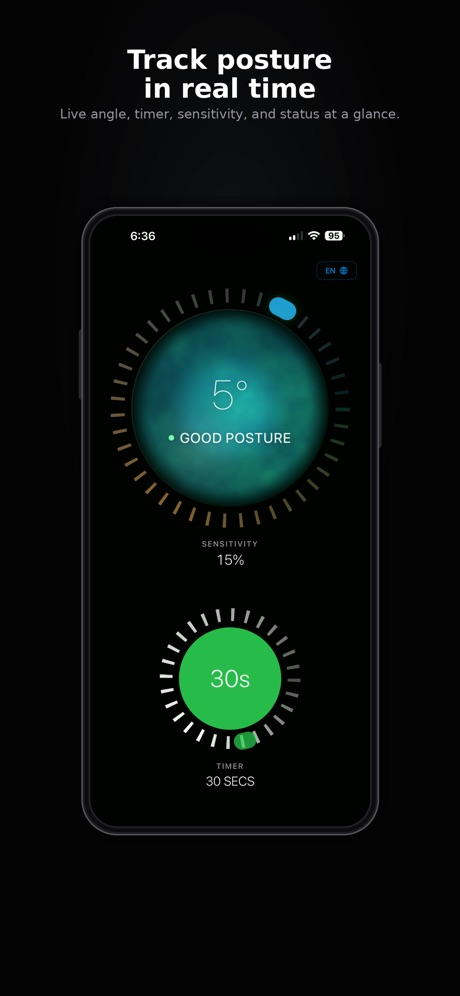
  &nbsp;
  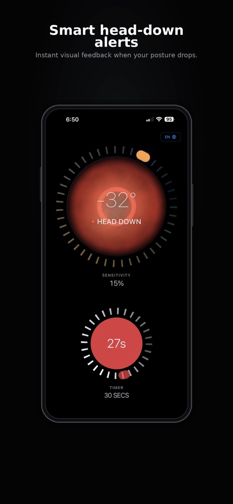
  &nbsp;
  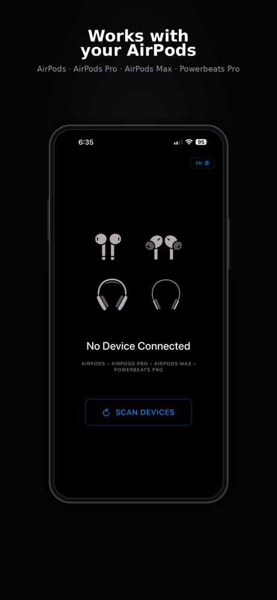

  
   
  <b>App Store id6747050863</b> · Released April 2026 · v1.0 (build 35) · Health &amp; Fitness
   
  iOS 26+ · Works with AirPods Pro, AirPods Max &amp; Powerbeats Pro · Apple Watch app optional

**Under the hood**

- 🎧 **Real-time motion pipeline**: an AirPods gyroscope and IMU pipeline streams pitch, roll, yaw, and accelerometer data at 25 Hz, runs on-device classification with dynamic head-down threshold calibration, and drives a 3D head visualization that mirrors the live sensor stream.
- ⌚ **Apple Watch companion**: posture state syncs over a multi-channel WatchConnectivity pipeline, with 3-second cooldown flood protection on iPhone, 30–60-second freshness validation on Watch, a live on-Watch display, and haptic alerts.
- 🩺 **Crash diagnosis**: traced a recurring crash on Apple Watch reachability flips and retired the real-time `sendMessage` channel in favor of deferred `updateApplicationContext` and `transferUserInfo` delivery.
- ⚡ **Swift 6**: full strict-concurrency migration across all targets.
- 🏝️ **Live Activities & Dynamic Island**: 100 ms update precision with background continuity.
- ♿ **Accessibility in 8 languages**: end-to-end Apple HIG accessibility, including VoiceOver, Dynamic Type across the full range with adaptive layout switching, high contrast, button shapes, Reduce Motion, and custom accessibility actions, in English, Turkish, German, French, Spanish, Arabic, Japanese, and Korean.

### StratoSync · Apple Vision Pro

<a href="https://apps.apple.com/us/app/stratosync/id6747596499">
  
</a>

**Most immersive apps load their surroundings. StratoSync computes them.** The sky is generated on the GPU every display refresh, the sunlight comes from the real solar position, and live ISS telemetry moves through the scene, which you can observe, manipulate, share, and understand spatially.

  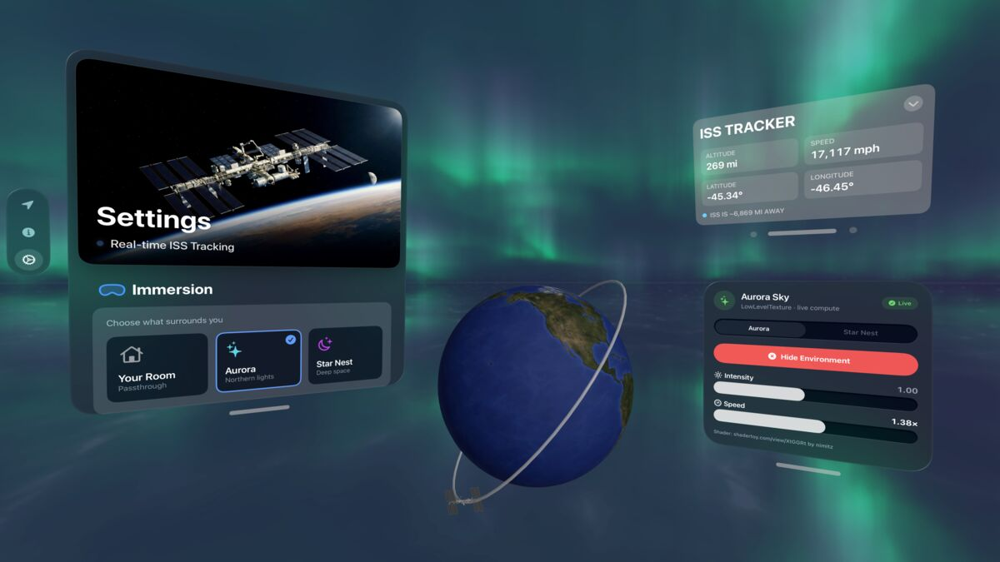
  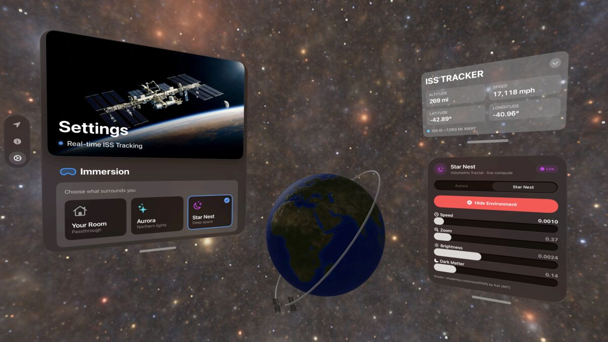
  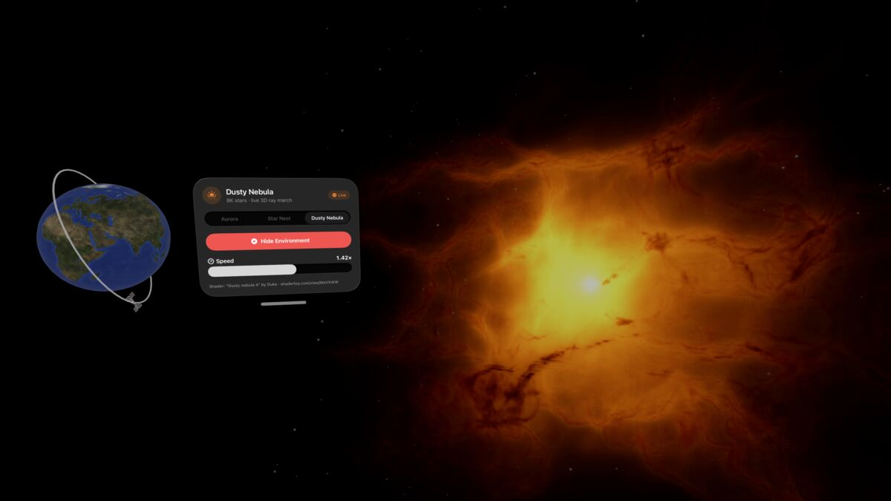
   
  <i>Aurora · Star Nest · Dusty Nebula: generated by Metal compute kernels at runtime, not loaded from images</i>

  
   
  <b>App Store id6747596499</b> · Released September 2026 · v2.1 · Education · visionOS 26+ · Apple Vision Pro · Free

**Under the hood**

- 🌌 **Computed, not loaded**: three environments (Aurora, Star Nest, and Dusty Nebula) are generated by Metal compute kernels at runtime instead of shipping as sky images.
- ☀️ **Real sunlight**: Earth is lit from the Sun's current position, so the day/night terminator matches the moment you are in.
- 🛰️ **Live ISS**: real telemetry moves the station through the scene, and you can grab, scale, and inspect it in 3D.
- ✍️ **Spatial drawing**: Apple Pencil and Logitech Muse stylus support for 3D drawing, with scale compensation in immersive space.
- 🌗 **Mixed & full immersion**: synchronized state across both modes, plus SharePlay for exploring together.

> ⭐ **Tried one of them?** A rating or review on the App Store helps an independent developer get discovered.

---

## 📊 GitHub Stats

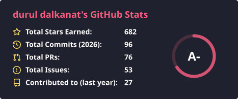
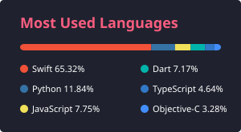

---

## 🌍 Open Source Contributions

I contribute across Apple platforms, visionOS, Swift, developer tooling, AI/ML infrastructure, spatial computing, and documentation-heavy open source projects.

### Notable external contributions

| Project                                                                                                           | Area                                    | Contribution                                                                                                                                                                                                                                                                                  |
| ----------------------------------------------------------------------------------------------------------------- | --------------------------------------- | --------------------------------------------------------------------------------------------------------------------------------------------------------------------------------------------------------------------------------------------------------------------------------------------- |
| [SouthwestAir/Vision-Pro-Blender-Live-Streamer](https://github.com/SouthwestAir/Vision-Pro-Blender-Live-Streamer) | visionOS / Blender streaming            | UI, README, status throttling, and AppModel refactors                                                                                                                                                                                                                                         |
| [NVIDIA/NemoClaw](https://github.com/NVIDIA/NemoClaw)                                                             | CLI / sandbox diagnostics               | Merged [PR #2848](https://github.com/NVIDIA/NemoClaw/pull/2848) into NVIDIA's `main`: added the `nemoclaw <name> doctor` CLI command — health checks for sandbox, gateway, inference, messaging, Ollama & cloudflared, with CLI implementation, docs, tests & JSON output                     |
| [kennss/SiliconScope](https://github.com/kennss/SiliconScope)                                                     | **Metal / GPU** · Apple Silicon · Swift | Named the project; shipped the AI-workload bottleneck classifier that emits the **`"LLM (GPU/Metal)"`** engine verdict (Metal/GPU-compute vs ANE/CoreML attribution), plus GPU throttle detection & a compact GPU menu-bar mode (merged); added a no-notarization local `.app` bundle builder |
| [Simbastack-hq/framedex](https://github.com/Simbastack-hq/framedex)                                               | Apple Photos / CLI / media indexing     | Added `fdx-photos` for indexing videos directly from an Apple Photos library                                                                                                                                                                                                                  |
| [tddworks/SkillsManager](https://github.com/tddworks/SkillsManager)                                               | Swift / macOS tooling / security        | Added local `.app` build script and fixed symlink traversal risk                                                                                                                                                                                                                              |
| [vlr-code/dictly](https://github.com/vlr-code/dictly)                                                             | macOS / audio / accessibility           | Added diagnostics, fixed audio device rebinding, improved hotkey recording                                                                                                                                                                                                                    |
| [Jaennaet/pISSStream](https://github.com/Jaennaet/pISSStream)                                                     | visionOS / immersive UI                 | Added visionOS support and immersive experience improvements                                                                                                                                                                                                                                  |
| [nv-tlabs/lyra](https://github.com/nv-tlabs/lyra)                                                                 | AI / ML infrastructure                  | Added RunPod Lyra-2 installation runbook                                                                                                                                                                                                                                                      |
| [LaurieWired/Malimite](https://github.com/LaurieWired/Malimite)                                                   | Reverse engineering tooling docs        | Expanded README with architecture and usage details                                                                                                                                                                                                                                           |

More external projects I have contributed to

 

- [tddworks/baguette](https://github.com/tddworks/baguette)
- [TomBadash/Mouser](https://github.com/TomBadash/Mouser)
- [saulsharma/netflix-ui](https://github.com/saulsharma/netflix-ui)
- [khaled-0/Syncara](https://github.com/khaled-0/Syncara)
- [Safal-Shrestha-SS/audio_transcribe](https://github.com/Safal-Shrestha-SS/audio_transcribe)
- [JakeLin/SwiftLanguageWeather](https://github.com/JakeLin/SwiftLanguageWeather)

## 🐞 Bug Reports Filed Upstream

Platform and tooling bugs I have hit, reduced to a reproducible case, and reported to the vendor, or backed with diagnostic data and design input on existing reports.

| Vendor          | Report                                                                                                                                                                                                                 | Area              | Summary                                                                                                                                     | Filed    |
| --------------- | ---------------------------------------------------------------------------------------------------------------------------------------------------------------------------------------------------------------------- | ----------------- | ------------------------------------------------------------------------------------------------------------------------------------------- | -------- |
| Apple           | `FB25367817`                                                                                                                                                                                                           | Foundation Models | `SystemLanguageModel` reports an unsupported device language as `.modelNotReady`, so apps show a download message instead of a language fix | Oct 2026 |
| Apple           | `FB25367740`                                                                                                                                                                                                           | Foundation Models | `foundation-models-utilities`: the model can still deactivate a `Skill(allowsDeactivation: false)`, even with `strictSchema: true`          | Oct 2026 |
| Apple           | `FB24900015`                                                                                                                                                                                                           | ScreenCaptureKit  | In-app capture (`presentPickerForCurrentApplication`) fails with `RPRecordingErrorDomain -5807` when the app has more than one window open  | Sep 2026 |
| Apple           | `FB22814526`                                                                                                                                                                                                           | ARKit             | `ARWorldTrackingConfiguration` emits `AREnvironmentProbeAnchor` even when `environmentTexturing = .none` (iOS 26.5, iPhone 17 Pro)          | May 2026 |
| Google Research | [harness2#5](https://github.com/google-research/harness2/issues/5#issuecomment-6274854482)    | Agent harness     | Design input on a `--bench local` proposal: clean copy per rollout, verify by real build/test exit status, keep grades out of agent context | Oct 2026 |
| oMLX            | [omlx#1835](https://github.com/jundot/omlx/issues/1835#issuecomment-6022541666)                         | MLX / macOS 27    | Added a data point: on macOS 27 (M5 Pro), MLX *and* llama.cpp decode dropped 10–20× even at short context, until a reboot                   | Oct 2026 |
| OpenAI          | [codex#34031](https://github.com/openai/codex/issues/34031)                                           | Codex app         | GPT-5.6 missing from the ChatGPT Classic model picker after the 1.2026.184 update                                                           | Jul 2026 |

> **Seeing the same bug?** For Apple, file your own report in [Feedback Assistant](https://feedbackassistant.apple.com/) and mention the FB number. For GitHub issues, add a 👍. Duplicate reports raise a bug's priority.

## 🔥 Contribution Streak

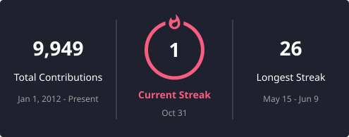

---

## 📈 Activity Graph

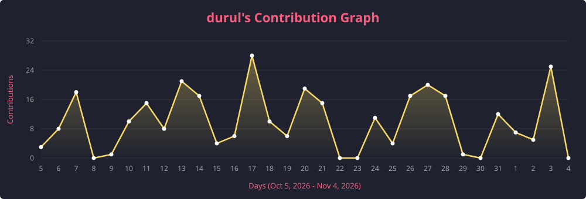

---

## 🏆 GitHub Trophies

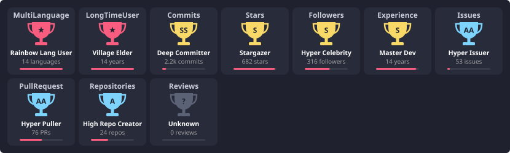

---

## 📊 Detailed Metrics

---

